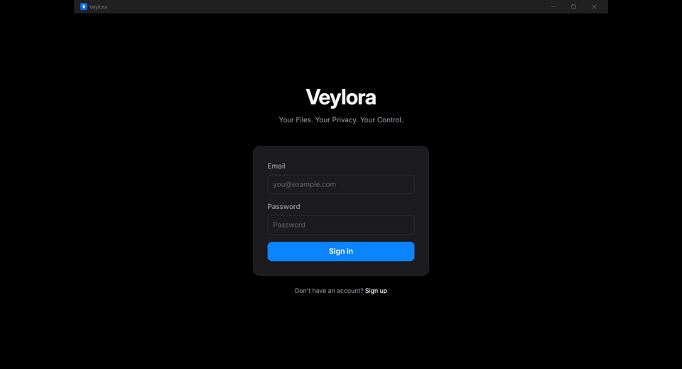
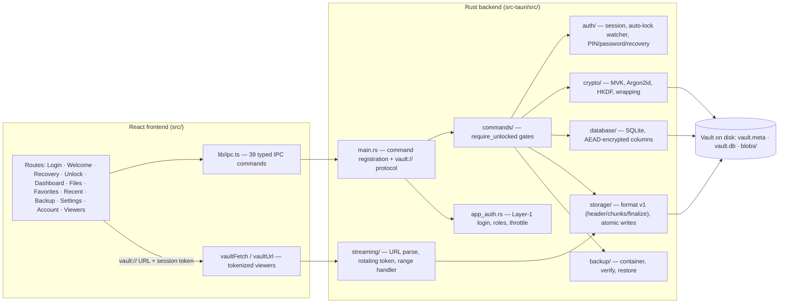

<div align="center">

# 🔐 Veylora

**A local-first Windows desktop application for an encrypted file vault — files are encrypted *before* they touch disk, and decrypted bytes exist only in memory while you view them.**


[](https://tauri.app)
[](https://react.dev)
[](https://www.typescriptlang.org)
[](https://vite.dev)
[](https://tailwindcss.com)
[](https://www.rust-lang.org)
[](#-testing-and-verification)
[](#-installation)
[](#-license)

[✨ Features](#-features) · [🧰 Tech stack](#-tech-stack) · [🏛 Architecture](#-architecture) · [⬇️ Installation](#-installation) · [💻 Developer setup](#-developer-setup) · [🚀 Usage](#-usage-walkthrough) · [🔐 Security](#-security-and-privacy) · [🧪 Testing](#-testing-and-verification) · [⚠️ Limitations](#-limitations-and-known-issues) · [🗺 Roadmap](#-roadmap)



</div>

---

## 🔐 Introduction

**Veylora** turns a folder on your Windows machine into an encrypted vault. Import a file and it is sealed with **XChaCha20-Poly1305** before any plaintext byte reaches persistent storage; open a file and the decrypted bytes stream through RAM only, handed to the viewer by a custom `vault://` protocol — never written back to disk as plaintext.

**The problem it solves.** Cloud drives require trusting the operator and being online. Full-disk encryption protects the whole disk with a single credential, but leaves every file readable the moment the OS is unlocked, with no per-file control. Veylora sits between the two: per-file encryption at rest, **three independent credentials** (PIN, master password, recovery key) that unwrap one master key, an app-level login in front of every screen, tamper detection on every chunk, and backups you can verify — all completely offline.

**Who it is for.** Windows users who want personal documents, photos and media encrypted at rest in a fast native app — no account, no server, no subscription.

**Why Rust + Tauri.** Key material lives in RAM, so the platform matters. Rust gives memory safety plus zero-cost `zeroize` (keys are wiped the instant the vault locks); the RustCrypto crates supply Argon2id, XChaCha20-Poly1305 and HKDF with no C toolchain; `rusqlite` bundles SQLite so there is no system dependency. Tauri keeps the shell tiny — the installer is ~3.2 MB and the UI runs on Windows' preinstalled WebView2 instead of a bundled browser.

**Maturity.** This is a **functional v1.0.0 suitable for personal use**: the NSIS installer builds, installs and launches; **168 Rust + 70 frontend tests pass**; and a full packaged-app smoke run (first-run wipe → login → vault creation → recovery → import → viewer render → lock → keypad unlock → dashboard counts) exits green on the final artifact. The security review is **internal** ([`docs/SECURITY_REVIEW.md`](docs/SECURITY_REVIEW.md)), not an external audit; the installer is unsigned; and known issues are listed under [Limitations](#-limitations-and-known-issues).

**Deliberately out of scope:** cloud sync, incremental backup, and an auto-backup scheduler. Veylora is local-only by design.

> ⚠️ **Not a DRM or access bypass.** Veylora encrypts files *you* put into it. It has no affiliation with any content platform and circumvents no protection schemes.

---

## ✨ Features

### 🔒 Three-layer security model

- **Layer 1 — App login.** Email + password in front of every screen. Passwords are Argon2id-hashed with a fresh 32-byte salt per password and verified in constant time; roles (`admin`/`user`) are enforced **server-side**; login errors are uniform; brute-force throttling with exponential backoff is persisted across restarts. A seeded admin account shows an in-app warning until you change the default password.
- **Layer 2 — Vault gate.** Create a new vault or open an existing one by path, then unlock with a **PIN keypad (4–6 digits)**, a **master password (≥ 8 characters)**, or a **one-time recovery key** — 56 characters of base32 plus a SHA-256 checksum, displayed exactly once at creation and never re-displayable.
- **Layer 3 — Encryption at rest.** All three credentials unwrap the same **Master Vault Key (MVK)** into RAM. The MVK never crosses the IPC boundary and is zeroized on lock.

### 🛡️ Cryptography (RustCrypto)

- **XChaCha20-Poly1305** AEAD for file chunks and for sensitive metadata columns in SQLite.
- **Argon2id** key derivation (t=3, lanes=1; the PIN path uses 64 MiB of memory) — the app login reuses the same parameters.
- **HKDF-SHA256** with **8 frozen, domain-separated labels** (chunk keys, nonces, backup key, recovery wrap, …). Labels are part of the format contract and never reused.
- **File format v1:** an AEAD header (AAD-bound magic + version), **64 KiB** AEAD chunks with deterministic nonces, and a finalize record binding a root hash. Modified, reordered, duplicated, or truncated chunks are *detected* — a tampered vault fails to read rather than silently returning wrong bytes.
- **Memory hygiene:** `zeroize`/`ZeroizeOnDrop` on every key container; `subtle` constant-time equality for tokens and credentials.

### 🎥 Protected streaming & viewers

- A custom **`vault://` protocol** registered directly with Tauri: range-capable, session-token authenticated, decrypted per-request in memory.
- **Rotating session token** with constant-time checks — and a **mid-stream lock that immediately 403s** in-flight streams when the vault locks.
- Built-in **image viewer**, **video player** (HTML5 `<video>` with seeking over range requests), and **PDF viewer** (WebView2's native renderer fed through an `<iframe>` over `vault://`).
- The only plaintext paths are explicit, user-initiated **exports**. No temp files, no preview caches, no OS thumbnail leakage.

### 📁 File management

- **Import** via button, drag-and-drop from Explorer, or <kbd>Ctrl</kbd>+<kbd>O</kbd>; **export**, **rename**, **delete**; folders with create / move / **move dialog** / rename.
- **Favorites**, **recent**, instant **search**, sort by name/date/size, **batch select** with multi-export and multi-delete, and a right-click **context menu** — where every action also has a visible button (the menu is an accelerator, never the only path).
- **Dashboard** with stat cards (`N files encrypted`, `Storage: …`, last backup), a wide **Quick Import** drop zone, and Recent/Favorites lists.

### 💾 Backup & recovery

- **Manual, encrypted, self-contained backup containers** bound to the vault's MVK — a container created from another vault cannot be restored into yours.
- **Verify** integrity without decrypting file contents (container structure + root-hash check).
- **Restore** transactionally with overwrite-conflict handling; backup history with a one-click, two-step-confirm clear.
- Automatic backups are a deliberate non-goal: backups are always an explicit user action.

### 🖥️ Experience

- Dark, keyboard-first UI: <kbd>Ctrl</kbd>+<kbd>/</kbd> shortcut cheat sheet, <kbd>Ctrl</kbd>+<kbd>L</kbd> instant lock, quick-jump <kbd>Ctrl</kbd>+<kbd>1…4</kbd>, **back/forward history arrows** on every page, toasts, and friendly empty states.
- Auto-lock watcher (1 / 5 / 15 / 30 minutes, default 5) fed by a throttled activity heartbeat (one IPC call per minute).
- First-run flow wipes stale state, the recovery key is shown exactly once, and destructive actions (delete vault, clear history) require typed confirmation.

---

## 🧰 Tech stack

| Technology | Version (verified) | Purpose | Role |
|---|---|---|---|
| [Tauri](https://tauri.app) | 2 (resolves 2.12.4) | App framework, IPC, `vault://` protocol | Build + runtime |
| tauri-plugin-dialog | 2 | Native file/folder pickers | Runtime |
| [React](https://react.dev) | ^18.2 | UI layer | Runtime |
| [TypeScript](https://www.typescriptlang.org) | ^5 (strict) | Types across the IPC seam | Build |
| [react-router-dom](https://reactrouter.com) | ^7.18 | Page routing + history arrows | Runtime |
| [Vite](https://vite.dev) | ^7.3.8 | Dev server + production bundle | Build |
| [Tailwind CSS](https://tailwindcss.com) | ^3.4 | Styling (design tokens in `tailwind.config.ts`) | Build |
| [lucide-react](https://lucide.dev) | ^0.344 | Icons | Runtime |
| [Rust](https://www.rust-lang.org) | 1.99.0 | Backend, crypto, storage, streaming | Build |
| [argon2](https://docs.rs/argon2) | 0.5 | Argon2id KEK + login-password hashing | Runtime |
| [chacha20poly1305](https://docs.rs/chacha20poly1305) | 0.11 | XChaCha20-Poly1305 AEAD | Runtime |
| [hkdf](https://docs.rs/hkdf) / [sha2](https://docs.rs/sha2) | 0.12 / 0.10 | Subkey derivation, checksums | Runtime |
| [zeroize](https://docs.rs/zeroize) / [subtle](https://docs.rs/subtle) | 1.7 / 2 | Key wiping, constant-time compares | Runtime |
| [getrandom](https://docs.rs/getrandom) | 0.2 | OS CSPRNG for all key material | Runtime |
| [rusqlite](https://docs.rs/rusqlite) (bundled) | 0.41 | Metadata DB (WAL + `synchronous=FULL`) | Runtime |
| serde / serde_json | 1 | (De)serialization | Runtime |
| [Vitest](https://vitest.dev) + jsdom | ^5.1 | Frontend tests (68) | Test |
| Node.js / pnpm | v22.21.1 / 8.15.9 | Tooling, build scripts | Build |
| NSIS (via Tauri bundler) | — | Per-user Windows installer | Build |

---

## 🏛 Architecture



**Communication.** The frontend never handles key material, never opens SQLite, and never touches vault files directly. Everything crosses **39 typed Tauri IPC commands** declared in `src/lib/ipc.ts`; media bytes cross the **`vault://`** URI-scheme protocol with a per-session token. Every vault-data command passes a `require_unlocked` gate in Rust, and admin-only operations re-check the role server-side — hiding a button is never the security control.

**Repository structure**

```
src/
  App.tsx                 Shell: nav, history arrows, shortcuts, gates
  routes/                 login, welcome, recovery, unlock, dashboard,
                          filemanager, favorites, recent, backup,
                          settings, account, imageviewer, pdfviewer, videoplayer
  lib/                    ipc.ts (command wrappers), vaultUrl/vaultFetch,
                          sort, format, dragDrop, types (+ tests)
  components/ui/          button, card, input, label, locked-modal
src-tauri/src/
  main.rs                 39 IPC command handlers + vault:// protocol
  commands/               vault ops + files/folders (require_unlocked)
  app_auth.rs             Layer-1 accounts (Argon2id, roles, throttle)
  auth/                   session manager, auto-lock watcher, PIN/password/recovery
  crypto/                 MVK, Argon2id KDF, HKDF labels, wrapping, recovery key
  database/               schema, files, folders, favorites, AEAD columns
  storage/                format v1 (header, chunk, finalize, reader, writer),
                          blob I/O, crash-safe temp+rename, vault layout
  streaming/              URL parsing, rotating token, range protocol handler
  backup/                 container, create, verify, restore
docs/                     ARCHITECTURE, CRYPTO_DESIGN, SECURITY_REVIEW,
                          IMPLEMENTATION_STATUS, assets/
```

**Data flow, end to end**

1. **Import** — `file_import_cmd` re-checks the unlock gate, encrypts each file into 64 KiB AEAD chunks under a fresh per-file key, writes blobs via temp-file + fsync + atomic rename, and stores only AEAD-encrypted metadata in `vault.db`.
2. **Unlock** — Argon2id derives the KEK from your PIN/password (or HKDF unwraps with the recovery key); the KEK unwraps the MVK into a zeroized container; a session token is issued for `vault://` URLs.
3. **View** — the viewer requests `http://vault.localhost/file/<id>?token=…`; the registered protocol handler authenticates the token in constant time, reads the byte range, decrypts chunks in memory, and streams them back. Locking the vault flips every subsequent request to **403** immediately.
4. **Backup** — an HKDF subkey (`backup_key`) encrypts a self-contained container; **verify** checks structure and root hash without decrypting payloads; **restore** rebuilds blobs and metadata transactionally, and only for the same MVK.

---

## ⬇️ Installation

### End users (Windows x64)

The production build produces a per-user NSIS installer (no admin rights required):

```
src-tauri\target\release\bundle\nsis\Veylora_1.0.0_x64-setup.exe   (~3.2 MB)
```

> This is a **local build output path**. Published releases land on the GitHub Releases page together with `RELEASE_NOTES.md`, which contains the expected **SHA-256** of the installer — always verify it before running:
>
> ```powershell
> certutil -hashfile Veylora_1.0.0_x64-setup.exe SHA256
> ```

Requirements:

- **Windows 10/11 x64** with the **WebView2 Runtime** (preinstalled on current Windows 11; otherwise from [Microsoft](https://developer.microsoft.com/microsoft-edge/webview2/)).
- Nothing else — no runtime, no database, no media tools. The vault is pure local files.

> ⚠️ **The installer is unsigned (no code-signing certificate yet).** Windows SmartScreen will show *"Windows protected your PC"* → **More info** → **Run anyway**. Verify the SHA-256 first.

### Developers

See [Developer setup](#-developer-setup).

---

## 💻 Developer setup

Verified on Windows with the Rust MSVC toolchain, Node 22, and pnpm 8.

```powershell
# 1. Clone
git clone https://github.com/hariom710/Veylora.git
cd Veylora

# 2. Install frontend dependencies
pnpm install

# 3. Run in development (Vite dev server + Tauri window)
pnpm tauri dev
```

Quality checks (run from the repository root):

```powershell
pnpm typecheck            # tsc --noEmit — must report 0 errors
pnpm test                 # 70 frontend tests (Vitest + jsdom)
build.bat test            # 168 Rust tests, via the MSVC environment wrapper
pnpm build                # production frontend bundle
build.bat tauri build     # release binary + NSIS installer
```

Notes:

- **`build.bat`** locates Visual Studio through `vswhere`, loads `vcvars64`, then runs `cargo` in `src-tauri\` — edit its `cd` path if your checkout lives elsewhere. Without a C++ toolchain it fails with an explicit error.
- **`pnpm typecheck`** is a real gate (`tsc --noEmit`, 0 errors); CI runs it together with the tests on every push.
- **Icons:** after regenerating (`pnpm tauri icon app-icon.png`) a rebuild picks them up automatically — `build.rs` hashes the icon folder and forces the embed to recompile. Only the Windows Explorer icon cache may lag (see [Troubleshooting](#-troubleshooting)).

---

## 🚀 Usage walkthrough

1. **Launch** the installed app. Every cold start begins at the **Layer-1 login** (the session is in-memory only).
2. **Sign in** — a default admin account is seeded on first run; the app warns you until you change its password in **Settings**. *Sign up* on the login screen creates additional users.
3. **Create a vault** — name, folder path, a 4–6 digit PIN, and a master password (≥ 8 characters). *Open Vault* loads an existing vault instead.
4. **Save the recovery key** — shown **exactly once**; confirm the checkbox to continue. Without it, a forgotten PIN/password pair means the vault is unrecoverable by design.
5. **Dashboard** — stat cards show file count, storage used, and last backup. Import via **Import Files**, the **drag-and-drop zone**, or <kbd>Ctrl</kbd>+<kbd>O</kbd>.
6. **Files page** — per-file `Open` / `Export` / `Rename` / `Delete`, folders, the move dialog, sort, search, batch select, and a right-click context menu.
7. **View** — images, video and PDF open in-app over `vault://`; decrypted bytes never touch disk. Lock with <kbd>Ctrl</kbd>+<kbd>L</kbd> or **Lock Vault**, then unlock from the keypad (PIN / password / recovery tabs).
8. **Backup page** — **Create** a container, **Verify** it, **Restore** it, and review or clear the history.
9. **Settings** — auto-lock timeout (1/5/15/30 min), change PIN, change master password, and a type-to-confirm **Danger Zone** to delete the vault.
10. **Account** — avatar, user management for admins (create/delete users), and **Sign out** (clears Layer 1 only).

**Keyboard shortcuts**

| Shortcut | Action |
| :--- | :--- |
| <kbd>Ctrl</kbd> + <kbd>/</kbd> | Show / hide the shortcut cheat sheet |
| <kbd>Ctrl</kbd> + <kbd>L</kbd> | Lock the vault immediately |
| <kbd>Ctrl</kbd> + <kbd>O</kbd> | Go to Files & open the import dialog |
| <kbd>Ctrl</kbd> + <kbd>F</kbd> | Go to Files & focus search |
| <kbd>Ctrl</kbd> + <kbd>,</kbd> | Open Settings |
| <kbd>Ctrl</kbd> + <kbd>Shift</kbd> + <kbd>A</kbd> | Open Account |
| <kbd>Ctrl</kbd> + <kbd>1…4</kbd> | Dashboard / Files / Backup / Settings |

---

## 🔐 Security and privacy

Veylora is a **fully local application**: no accounts on any server, no analytics, no telemetry, and no network calls of any kind — `vault://` is a loopback URI scheme handled inside the process.

**Verified safeguards**

- **Three-layer model** with server-side enforcement: every vault-data IPC command passes `require_unlocked` in Rust; admin operations re-check the role in Rust; login errors are uniform and throttling is persisted.
- **Key handling:** the MVK never crosses IPC; all key containers are `ZeroizeOnDrop`; token and credential comparisons are constant-time (`subtle`).
- **Argon2id everywhere** (vault KEKs and login passwords), fresh 32-byte salts, parameters in code with committed test vectors.
- **Format v1 integrity:** AEAD over every chunk plus a root-hash finalize record — modified, reordered, duplicated, or truncated data is detected on read.
- **8 frozen HKDF labels**, domain-separated; `backup_key` and recovery wrapping are label-bound, so cross-vault backup restore is impossible.
- **Mid-stream lock:** locking the vault 403s every in-flight and subsequent `vault://` request (covered by a dedicated test).
- **Encrypted metadata:** sensitive SQLite columns are individually AEAD-encrypted; the DB runs in WAL mode with `synchronous=FULL` and crash-safe temp+rename blob writes.
- **No plaintext leaks:** no temp files, no preview caches; the only plaintext write is an explicit user export.
- **Hardening surface:** minimal Tauri capabilities (no shell/fs plugins), no `innerHTML`/`eval`/`dangerouslySetInnerHTML` anywhere in the frontend (grepped).
- **Content-Security-Policy:** the webview ships a restrictive CSP (`default-src 'self'`, no remote origins) scoped to the loopback `vault://` media origin, and a single-instance lock so a second launch focuses the running window instead of sharing vault state.

**Known findings (open and disclosed)**

1. **No external audit** — [`docs/SECURITY_REVIEW.md`](docs/SECURITY_REVIEW.md) is an internal review.
2. **Unsigned installer, no auto-update** — see the SHA-256 workflow in [Installation](#-installation).
3. **Losing all three credentials** (PIN + password + recovery key) makes the vault permanently unrecoverable — by design.

**Threat model.** Veylora protects data at rest against offline disk access and detects vault tampering. It does **not** protect against kernel-level malware, a compromised OS, coerced disclosure, or a compromised WebView2 — the full "protects / does not protect" list lives in [`RELEASE_NOTES.md`](RELEASE_NOTES.md).

---

## 🧪 Testing and verification

Results from the full verification run (12 November 2026, Windows x64) — all freshly executed, none historical:

| Check | Result | Coverage limitation |
|---|---|---|
| `pnpm test` | **70/70 passed** (16 files) | jsdom component + unit tests; no real browser E2E |
| `cargo test` | **168 passed, 0 failed, 2 ignored** | Offline and deterministic by design |
| `pnpm typecheck` (`tsc --noEmit`) | **0 errors** (193 latent errors were hidden behind a broken config flag) | — |
| CI (`.github/workflows/ci.yml`) | Frontend: typecheck + lint + tests + build (Ubuntu); Rust: `fmt --check` + clippy `-D warnings` + tests, plus the full packaged build (Windows) | — |
| Packaged-app smoke (WebView2 CDP automation) | **Exit 0** on the final installer — first-run wipe → login → create vault → recovery → import → image viewer renders (64×64) → `vault://` fetch returns 200 → lock → keypad unlock → dashboard shows `1 files encrypted \| Storage: 494 B` | Committed as [`scripts/smoke.ps1`](scripts/smoke.ps1) (parameterized exe path, vault, creds, port, shot dir; asserts and non-zero exit on failure); run manually against the installed app |
| Installer SHA-256 | `3a546e3c…c13d` published in `RELEASE_NOTES.md` + `.sha256` sidecar | — |
| Icon embedding | Verified by extracting the icon from **both** the built and the installed exe | Manual |
| Test-data hygiene | Test vault and WebView2 localStorage wiped after every smoke run | — |

**Every test runs offline** — the app itself makes no network calls, so there are no flaky network-dependent tests to `#[ignore]`. The two ignored Rust tests are heavyweight suites excluded from the default run.

---

## ⚠️ Limitations and known issues

1. **Windows-only** — WebView2, NSIS, and Windows path semantics; other operating systems are unsupported.
2. **Distribution gaps** — no code signing (SmartScreen warning) and no auto-update; verify the SHA-256 from `RELEASE_NOTES.md` after every download. A single-instance lock keeps two launches from sharing vault state.
3. **Deferred by design** — Windows Hello unlock, Windows session-lock detection, incremental backup, auto-backup scheduler, and cloud sync are explicitly out of scope for v1.0 (see [Roadmap](#-roadmap) and `docs/SECURITY_REVIEW.md`).
4. **Recovery-key loss** — if the PIN, password, and recovery key are all lost, the data is unrecoverable; this is a feature of the design, not a bug.

---

## 🗺 Roadmap

### P1 — correctness and quality

- [x] Parameterize and commit the packaged-app smoke script

### P2 — platform (deferred from the security review)

- [ ] Windows Hello unlock (TPM/DPAPI work — needs independent review before shipping)
- [ ] Signed installer + Tauri auto-update
- [ ] Windows session-lock detection (WTS) for instant auto-lock
- [ ] Browser-based E2E suite

---

## 🩹 Troubleshooting

| Symptom | Likely cause | What to do |
|---|---|---|
| SmartScreen blocks the installer | The installer is unsigned | **More info → Run anyway**, after verifying the SHA-256 from `RELEASE_NOTES.md` |
| Desktop/taskbar still shows the old icon | Windows icon cache lag | Right-click Desktop → **Refresh**, or restart Explorer |
| exe keeps the old icon after `pnpm tauri icon` | build.rs now re-runs automatically | Rebuild; if only Explorer still lags, refresh the desktop icon cache |
| Vault locks while you are reading | Auto-lock timer elapsed | Re-unlock; raise the timeout in **Settings** (1/5/15/30 min) |
| Viewer shows 403 / goes blank after locking | Mid-stream lock (by design) | Unlock and reopen the file |
| Forgot PIN or master password | — | Unlock with the **recovery key** (Settings shows the flow); if all three are lost, the vault is unrecoverable by design |
| "Admin account is using the default password" banner | Seeded first-run account | **Settings → change password** |
| `build.bat` reports no MSVC toolchain | Missing C++ build tools | Install VS Build Tools with *Desktop development with C++* + Windows SDK |
| `pnpm test` fails to start | Dependencies not installed | `pnpm install` |
| Import fails silently | Vault locked or disk full | Unlock the vault, check free space, and watch the toast/error banner on the Dashboard |
| Backup restore refuses a file | Container from a different vault | Backups are bound to the originating MVK — restore only into the vault that created it |

When reporting a problem, include: app version (`RELEASE_NOTES.md` / installer name), your Windows version, the exact error text, and steps to reproduction. Never include your PIN, password, or recovery key.

---

## 🤝 Contributing

Issues and pull requests are welcome. Before submitting, make sure these pass locally:

```powershell
pnpm typecheck
pnpm lint
pnpm test
build.bat test
pnpm build
```

Security-sensitive rules that must not regress:

- The MVK never crosses the IPC boundary; every key container stays `ZeroizeOnDrop`.
- Every vault-data command keeps its `require_unlocked` (or role) gate in **Rust**, not in the UI.
- The 8 HKDF labels and format v1 stay frozen — changing them breaks every existing vault.
- No `innerHTML`/`eval` in the frontend; no shell-string process spawning.

---

## 📜 License

This project is dual-licensed, as declared in [`src-tauri/Cargo.toml`](src-tauri/Cargo.toml):

- [`LICENSE-MIT`](LICENSE-MIT) — MIT License, or
- [`LICENSE-APACHE`](LICENSE-APACHE) — [Apache License, Version 2.0](https://www.apache.org/licenses/LICENSE-2.0)

at your option.

---

## 🙏 Acknowledgments

Built on the work of many open-source projects — no affiliation or endorsement is implied:

- [Tauri](https://tauri.app) — the application framework and `vault://` protocol host
- [React](https://react.dev), [Vite](https://vite.dev), [Tailwind CSS](https://tailwindcss.com), [TypeScript](https://www.typescriptlang.org), [react-router](https://reactrouter.com), [lucide](https://lucide.dev) — the frontend toolchain
- [Rust](https://www.rust-lang.org) and the [RustCrypto](https://rustcrypto.org) project — `argon2`, `chacha20poly1305`, `hkdf`, `sha2`, `zeroize`, `subtle`, `getrandom`
- [SQLite](https://sqlite.org) via [rusqlite](https://github.com/rusqlite/rusqlite) — encrypted metadata storage
- [WebView2](https://developer.microsoft.com/microsoft-edge/webview2/) — the rendering runtime
